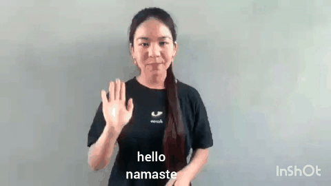
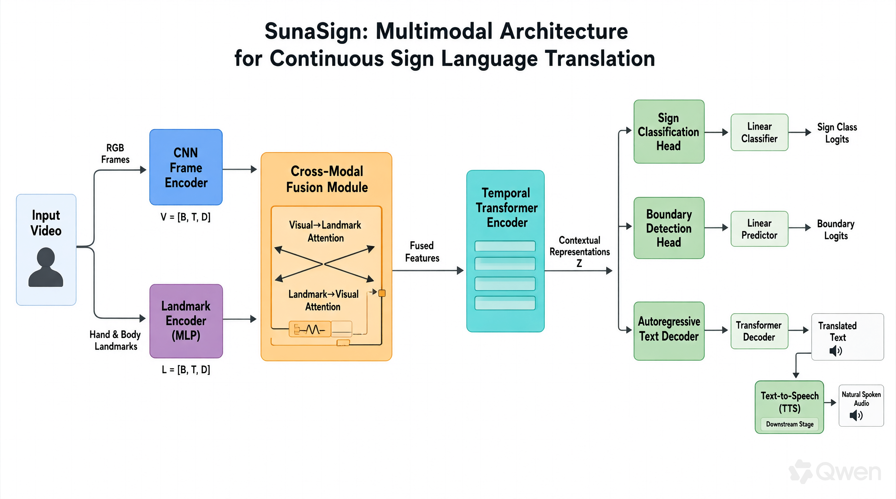

## De

---

##  SunaSign Architecture

SunaSign is a multimodal, Transformer-based architecture for continuous sign language recognition and translation (*Sign language to AUDIO*) . It combines visual video features and body landmark information to generate text, which can subsequently be converted into speech.

It would be very useful for those who can not speak and hear. 

### Architecture Components

| Component | Responsibility |
|---|---|
| CNN Frame Encoder | Extracts visual features from RGB frames |
| Landmark Encoder | Encodes hand and body landmark information |
| Cross-Modal Fusion | Combines visual and landmark representations using attention |
| Temporal Transformer | Models temporal relationships across video frames |
| Sign Classification Head | Predicts sign classes |
| Boundary Detection Head | Predicts temporal sign boundaries |
| Text Decoder | Generates translated text autoregressively |
| Text-to-Speech | Converts generated text into spoken audio |

### End-to-End Pipeline

**Video Input → Visual & Landmark Encoding → Cross-Modal Fusion → Temporal Modeling → Sign Recognition & Text Translation → Speech Generation**

## Important
This repository is intentionally dataset-agnostic. It does not claim that a pretrained model understands NSL.
You must provide consented NSL video/annotation data before training.

## Pipeline
video -> frame encoder -> landmark encoder -> multimodal fusion -> temporal transformer
-> sign logits + boundary logits -> text decoder -> TTS adapter

## Quick start
python -m venv .venv
source .venv/bin/activate
pip install -r requirements.txt

# smoke test with synthetic tensors
python scripts/smoke_test.py

# train
python -m suna_sign.train --config configs/base.yaml

# realtime inference (after training)
python -m suna_sign.infer --checkpoint checkpoints/best.pt --camera 0

## Dataset format
Each JSONL row:
{"video":"relative/path.mp4","text":"मलाई पानी चाहिन्छ।","gloss":["ME","WATER","WANT"],"segments":[[0,30],[31,70],[71,110]],"signer_id":"S001","split":"train"}

Splits MUST be signer-independent.
